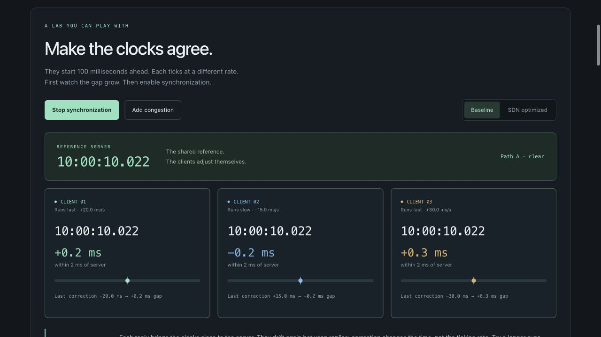
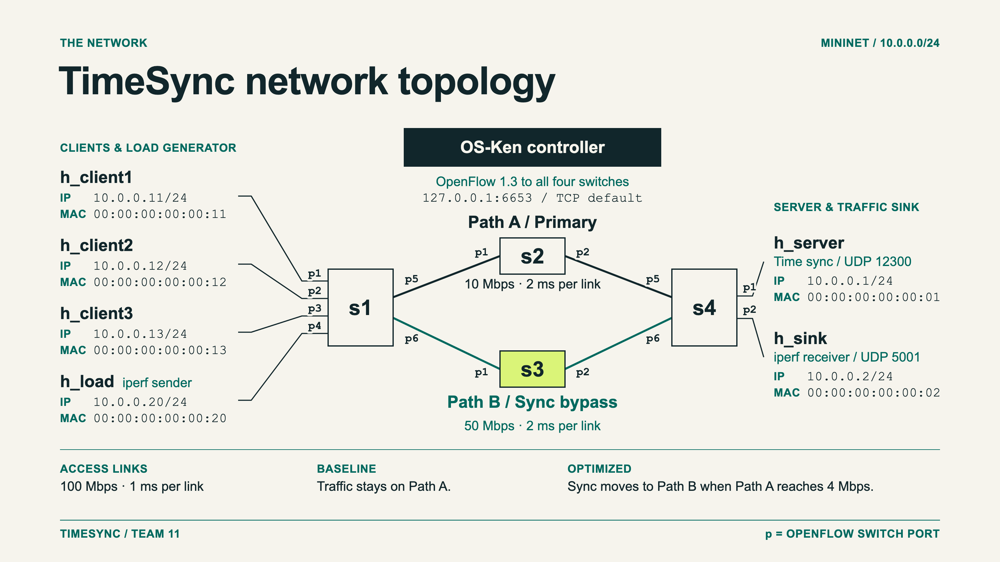
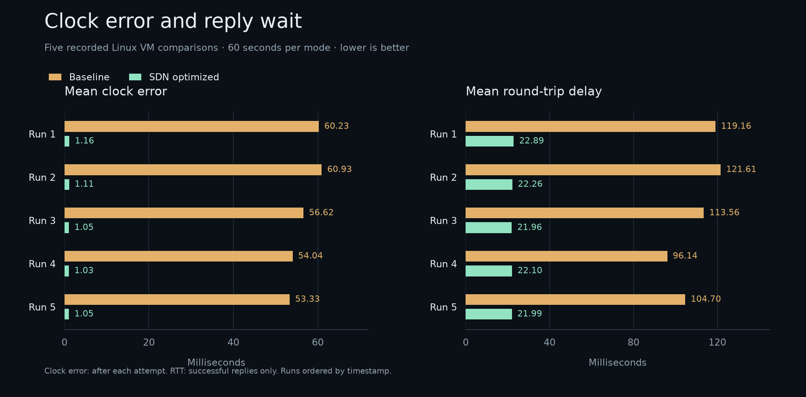

# TimeSync

Watch three drifting clocks synchronize over UDP, then see how a busy network
changes the result. TimeSync compares ordinary forwarding with prioritized
traffic and automatic path changes in a Linux Mininet network.

## Project documents

- [Project presentation (PDF)](docs/TimeSync%20-%20Project%2023.pdf)
- [Demo commands (PDF)](docs/Time%20Sync-Commands.pdf) and [copyable demo guide](docs/DEMO.md)
- [Project report (PDF)](docs/Network_Time_Sync_Project_Report.pdf) / [editable Word report](docs/Network_Time_Sync_Project_Report.docx)
- [Full network topology (PNG)](assets/timesync-topology.png)
- [Documentation index](docs/README.md) and [final verification](docs/VERIFICATION.md)

## Try it in three steps

Use a **Linux VM with Ubuntu 24.04 or Linux Mint 22**, Python 3.12, Git, and sudo.
A network connection is needed for the first setup. From a terminal:

```bash
git clone --branch final https://github.com/Annadata-Aniketh/Network-Time-Sync.git
cd Network-Time-Sync
./timesync
```

The first launch installs Mininet, Open vSwitch, iperf, and an isolated Python
environment. It asks for sudo when needed, then opens the menu. Later launches
reuse the environment. Choose **`i`** to understand the system, then **`4`** to run
both modes. Nothing starts until you select an action. Your system clock stays
unchanged: only virtual client clocks are corrected.

Want to explore before running the VM? Open `web/index.html` in a browser, or run
`./timesync web`. The offline clock lab lets you stop synchronization, watch the
clocks drift, send an exchange, and change the network conditions. The evidence
section shows archived VM results.



## Present it in ten minutes

| Time | Action | What to explain |
| --- | --- | --- |
| 0–2 min | `i` guided walkthrough | Three clocks drift; a four-timestamp UDP exchange estimates a correction. Enter advances; `b` goes back; `q` returns. |
| 2–5 min | `4` comparison | Watch normal traffic, congestion, and added link delay. The live view explains each phase. |
| 5–7 min | `5`, then `6` | Compare reply wait, clock error, and failed attempts. Lower RTT and lower clock error mean different things. |
| 7–9 min | `9` recovery | Stop the load and verify that sync traffic returns to Path A. |
| 9–10 min | Show PASS checks | Explain the evidence and the limits of the measurement. |

Keep the default 60 seconds per mode and allow for network startup. Rehearse
once on your VM. The route follows controller reports;
the client values come from live CSVs.

Other controls: `1` checks the environment, `2` / `3` run a single mode,
`7` changes duration, `8` runs tests, `h` shows the demo plan, and `0` exits.
`NO_COLOR=1 ./timesync` disables colors. Redirected output stays plain.

## What happens on the network



Each comparison mode runs three phases: normal synchronization, UDP background
load, then load plus 50 ms delay and 15 ms jitter on Path A. Baseline stays on A.
Optimized mode prioritizes sync, caps background traffic at 6 Mbps, and polls the
primary uplink every two seconds. At 4 Mbps, it moves sync traffic to B. Three
consecutive low-load polls restore A. Settings live in `sdn/flow_rules.json`.

Sync requests and replies use **UDP 12300**. Background traffic uses **UDP 5001**.
The OpenFlow control connection uses TCP 6653; host connectivity probes use ICMP.
The application protocol remains UDP in both modes.

Recovery (`9`) is a separate test with no added delay: normal, load, then load
stopped. A PASS requires packets on B, removal of reroute rules, an increasing A
request counter, and replies to all three clients during recovery.

## Use it in your workspace

Keep `app/protocol.py` and `app/client.py` for the timestamp exchange and virtual
clock; run `python3 -m app.server --host <reference-IP>` on your reference host and
`python3 -m app.client --server-ip <reference-IP> --count 10` on a client. Allow
UDP 12300 between them. This demonstrates virtual clock correction, not OS time
synchronization. Reusing the network optimization also requires the OpenFlow
controller, OVS queues, and a topology with the same port mapping—start from
`topology/custom_topo.py` and `sdn/flow_rules.json`. Each module has `--help`.

## Results and repeatable runs

Each experiment creates `evaluation/runs/<run>/` with client CSVs, logs, flow
snapshots, and `run.json`. Choose `5` for plots and `6` for the summary; press
Enter to use the current run. To run without the menu:

```bash
./timesync --batch --scenario both --duration 60
./timesync --batch --scenario recovery --duration 60
./timesync test
```

Clock error is recorded **after each attempt**, not continuously between replies.
RTT uses successful replies only. Timeouts are failed attempts, not a packet-capture
loss rate. Queue treatment and rerouting change together, and Path B has more
capacity. Do not attribute every improvement to one mechanism.



Each pair shows one run's mean. The graph uses the
[audited VM results](evaluation/reference/audit.json), ordered by run timestamp.

`evaluation/reference/` preserves five real comparisons and one recovery test.
Recalculate them with `.venv/bin/python -m evaluation.audit_results`. Export new
VM results with `sudo bash scripts/export_results.sh`. The website has
separate, dependency-free tests: `node --test tests/clock-model.test.cjs`.
Node.js is optional and is not installed by VM setup.

Batch runs save measurements but do not generate comparison plots automatically.
Use menu option `5`, or run:

```bash
.venv/bin/python -m evaluation.plot_results --data-dir evaluation/runs/<run>
```

Use a completed `both` run for plots. Recovery writes its own PASS/FAIL summary.

## If something fails

- `./timesync doctor` checks tools, OVS, controller imports, and port 6653.
- `./timesync setup` retries installation or updates the project environment.
  Setup leaves system Python isolated and reuses completed downloads.
- Run one experiment at a time. Stop an old controller if port 6653 is occupied.
- After a crashed run, use `sudo mn -c` before retrying. Ctrl+C normally cleans up.
- Read `controller.log`, `connectivity.txt`, and startup flow dumps in the failed
  run's directory. Incomplete runs remain marked in `run.json`.

`app/` holds clocks and UDP messages, `sdn/` the controller, `topology/` the network,
`evaluation/` measurements and evidence, `scripts/` the CLI, and `web/` the browser lab.

## Development checks

See [testing and load checks](docs/TESTING.md) for the Python and browser suites,
Ruff, ESLint, ShellCheck, Bandit, dependency audits, and the Linux VM workflow.
GitHub Actions runs these checks on pull requests. The offline browser lab has
no runtime npm dependencies; Node.js 24 is needed only for its development tools.

The server defaults to loopback and admits at most 128 active or queued requests.
Remote clients require an explicit bind address. See the [security scope](SECURITY.md)
for the protections and the limits of this laboratory protocol.
