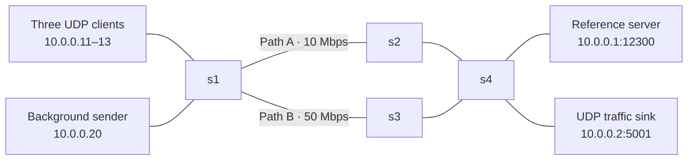

# Network Time Synchronization: implementation and VM results

Status: raw-data audit completed for five 60-second comparison runs and one
60-second recovery run on 2026-11-01. Source files are preserved in
[`evidence/vm-results-20261101-195256.tar.gz`](evidence/vm-results-20261101-195256.tar.gz).
All five stored summaries match fresh calculations from their CSVs. Reproducible
audit outputs are in [`results/`](results/).

## Objective

Measure how congestion and unequal directional delay affect a UDP clock
synchronization application, then compare ordinary forwarding with application
queues and automatic path changes. The application adjusts virtual client clocks;
it never sets the VM's system time.

## Architecture



Mininet provides host namespaces and links; Open vSwitch forwards packets. OS-Ken
2.11.2, a Ryu fork, programs OpenFlow 1.3 rules. The socket application and offered
background load use UDP. OpenFlow uses a TCP connection to port 6653; startup
connectivity checks use ICMP and ARP. These are separate from application transport.

All hosts have deterministic IP/MAC addresses. Client and background hosts attach
to s1; the reference server and background sink attach to s4. Path A traverses s2;
Path B traverses s3. Core delays are 2 ms per link and access delays are 1 ms.
Mininet uses HFSC for link rate shaping. The optimized policy configures separate
OVS HTB application queues on the Path A edge egress ports.

## UDP protocol and clock model

The 35-byte binary message uses `!4sBHIddd`: magic bytes, message type, client ID,
sequence number, and three double-precision timestamps. The fourth timestamp is
recorded locally when the client receives a response.

| Timestamp | Event | Clock |
| --- | --- | --- |
| t0 | Client sends request | Client virtual clock |
| t1 | Server receives request | VM reference clock |
| t2 | Server sends reply | VM reference clock |
| t3 | Client receives reply | Client virtual clock |

```text
RTT = (t3 - t0) - (t2 - t1)
offset = ((t1 - t0) + (t2 - t3)) / 2
corrected virtual time = virtual time + offset
```

The offset calculation assumes equal forward and reverse delays. A delay imbalance
is partly mistaken for clock error. The server uses a thread pool for concurrent
requests. Benchmark clients are persistent processes inside Mininet hosts, validate
reply identity and sequence, and write CSV samples. Invalid replies and timeouts
do not adjust their virtual clocks.

Clients start 100 ms ahead of the reference with drift rates of +20, -15, and
+30 ms/s. They request synchronization every 0.5 seconds and apply step correction.
These deliberately large artificial drift rates make the behavior visible.

## Network policy

Baseline mode forwards traffic over Path A without application queues or rerouting.
Optimized mode matches UDP port 12300, assigning queue 1 on Path A edge egress;
background UDP port 5001 uses queue 2, capped at 6 Mbps.

Every two seconds the controller reads s1 port 5's transmitted byte counter. It
computes Mbps from the change in bytes divided by elapsed time. At 4 Mbps or
above, it installs priority-200 sync rules on s1/s3/s4 for Path B. After three
consecutive below-threshold polls, it removes those rules using their cookie;
the original Path A rules remain. The threshold measures load, not queue delay.

## Experiments

Each 60-second comparison scenario runs normal traffic for 20 seconds, adds
12 Mbps offered UDP background load for 20 seconds, then retains the load while
adding 50 ms delay and 15 ms jitter to the forward s2 egress for the last 20 seconds.
The optimized policy changes both queue treatment and routing. This experiment
does not isolate their individual effects; Path B also has more capacity.

A separate recovery experiment uses normal traffic, load, and then load stopped
in equal thirds. It adds no impairment and does not manually restore flow rules.

### Repeated comparison results

Values below were recalculated from the raw CSVs. B = baseline; O = optimized.
RTT, jitter, and error values are milliseconds. Each run uses 60 seconds per mode.

| Run | Mean RTT B / O | P95 RTT B / O | Mean jitter B / O | Mean error B / O | P95 error B / O | Convergence B / O (s) | Failed samples B / O (%) |
| --- | --- | --- | --- | --- | --- | --- | --- |
| 20261101-190534 | 119.156 / 22.892 | 211.386 / 31.691 | 6.196 / 3.851 | 60.233 / 1.158 | 128.302 / 3.424 | 1.503 / 3.502 | 19.075 / 0.000 |
| 20261101-191520 | 121.607 / 22.259 | 219.360 / 29.481 | 6.528 / 3.320 | 60.927 / 1.110 | 127.624 / 3.133 | 1.503 / 5.502 | 20.506 / 0.000 |
| 20261101-192057 | 113.563 / 21.959 | 200.188 / 29.515 | 7.760 / 3.532 | 56.615 / 1.049 | 117.586 / 2.604 | 4.504 / 1.504 | 20.613 / 0.000 |
| 20261101-192459 | 96.142 / 22.097 | 196.668 / 28.305 | 8.441 / 3.171 | 54.041 / 1.034 | 139.642 / 2.977 | 8.006 / 3.502 | 28.783 / 0.000 |
| 20261101-193256 | 104.701 / 21.992 | 200.016 / 28.311 | 7.785 / 3.393 | 53.329 / 1.048 | 124.188 / 3.134 | 1.503 / 3.502 | 23.380 / 0.000 |

Across these five trials, optimized mean clock error was 1.034–1.158 ms,
compared with 53.329–60.927 ms for baseline. Optimized mean RTT was
21.959–22.892 ms, compared with 96.142–121.607 ms for baseline.
These are ranges of per-run means, not pooled means or confidence intervals.
Initial convergence varied and optimized mode was slower in two trials.
Continuous sub-millisecond accuracy is not established.

### Dynamic routing evidence

Raw phase-2 flow dumps show priority-200 requests leaving s1 port 6 in every
optimized comparison: 102, 111, 108, 111, and 102 packets, respectively. Each
controller log records the load trigger. The original
[flow screenshot](evidence/20261101-190534-reroute.png) remains as a visual example.

The recovery run `20261101-194117` passes independent re-evaluation against the
raw CSVs and saved flow dumps. Path B carried 108 sync requests under load;
priority-200 rules were absent on s1/s3/s4 after recovery; the Path A request
counter increased from 132 to 204; and all three clients received replies during
recovery. These counters establish path use and restoration, not an exact
recovery time. See [`results/audit.json`](results/audit.json).

## Failure analysis

The five baseline runs contain 1,753 attempts: 1,360 successes and 393 timeouts.
There are zero INVALID replies. All timeouts occur during the loaded phases;
normal-operation samples all succeed. Optimized mode contains 1,800 successes
from 1,800 attempts, with zero timeouts or invalid replies.

Matching client ID and sequence against server logs finds every successful
request, and none of the 393 timed-out baseline requests. This is consistent
with requests being lost before successful server handling, rather than replies
being rejected by client validation. The logs do not locate the drop point;
application timeouts are not presented as a direct packet-capture loss measure.

The baseline runs have unequal sample counts because a one-second timeout can
interrupt the nominal 0.5-second sampling schedule. Successful-only RTT statistics
exclude those missing replies and therefore underrepresent the worst failures.
Both error measurements and timeout counts should be reported alongside RTT.

## Runtime and network evidence

The exported environment records Linux Mint 22.3, kernel 7.0.0-42-generic,
Python 3.12.3, Mininet 2.3.0-1.1, Open vSwitch 3.3.9, iperf 2.1.9,
OS-Ken 2.11.2, Eventlet 0.40.4, pandas 3.1.0, NumPy 2.5.4, and matplotlib 3.11.2.
Versions were captured at export, rather than individually before each run.

Saved phase-3 qdiscs show HFSC bandwidth shaping with a netem child configured
for a 100-packet queue, 50 ms delay, and 15 ms jitter on `s2-eth2`. The controller
moves sync packets to Path B while that impairment remains on Path A.

For example, run 192057's iperf sender reports approximately 12.6 Mbit/s offered
load (`-b 12M`). Its baseline receiver reports 9.70 Mbit/s and its optimized
receiver 5.80 Mbit/s, consistent with the intended background queue cap. These
are background-stream measurements, not sync-stream loss statistics.

## Interpretation and limits

- RTT and jitter are computed from successful replies only. Post-correction clock
  error includes failed attempts and does not measure drift between requests.
- Mininet hosts share a reference clock. Direct residual-error measurement would
  not be available in the same way on independent physical machines.
- All recorded baseline failures are TIMEOUT, not INVALID. No packet trace
  isolates the exact loss point. Future experiments can capture packets at both
  endpoints to distinguish forwarding drops from other pre-handling failures.
- Convergence confirms three successive sample rounds with all clients within
  2 ms. It is not a measurement of controller reroute or recovery latency.
- Five runs demonstrate repeatability in this VM, not general statistical
  significance across platforms. Dependencies were recorded at archive export.

## Reproduction and evidence review

Follow the repository README for installation. Use menu option 4 for comparisons,
5 for plots, 8 for tests, and 9 for recovery. Logs and snapshots are retained per
run under `evaluation/runs/`.

Run `sudo bash scripts/export_results.sh` in the VM to generate a raw-data review,
record environment details, and create one transferable archive. The review
separates timeout and invalid replies per run and phase. The supplied archive has
been reviewed using the procedure below.

## Recompute the evidence

```bash
.venv/bin/python docs/build_results.py
```

This extracts the preserved archive into a temporary directory, rechecks summaries,
reconciles server logs, re-evaluates recovery, and writes review tables and JSON.
Archive SHA-256:
`3b094b35eebdcef4f8252b8a915cc629d7100e24c7aed5993e95093e7cade2a2`.

## Handoff

The [presentation](network-time-sync.pptx), screenshots, raw archive, and audit outputs are included
in this branch. The team should review the content and create its own PR. No
merge is required to reproduce the experiments from this branch.
