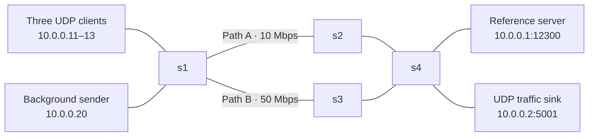

# Network Time Synchronization: implementation and VM results

Status: technical report draft. The results below are transcribed from the user's
VM screenshots saved in `evidence/`. Raw CSVs, logs, and installed VM versions
have not yet been transferred to this checkout for independent review.

## Objective

Measure how congestion and unequal directional delay affect a UDP clock
synchronization application, then compare ordinary forwarding with application
queues and automatic path changes. The application adjusts virtual client clocks;
it never sets the VM's system time.

## Architecture



Mininet provides host namespaces and links; Open vSwitch forwards packets. OS-Ken
2.11.2, a Ryu fork, programs OpenFlow 1.3 rules. The socket application and offered
background load use UDP. OpenFlow uses a TCP connection to port 6653; startup
connectivity checks use ICMP and ARP. These are separate from application transport.

All hosts have deterministic IP/MAC addresses. Client and background hosts attach
to s1; the reference server and background sink attach to s4. Path A traverses s2;
Path B traverses s3. Core delays are 2 ms per link and access delays are 1 ms.
Mininet uses HFSC for link rate shaping. The optimized policy configures separate
OVS HTB application queues on the Path A edge egress ports.

## UDP protocol and clock model

The 35-byte binary message uses `!4sBHIddd`: magic bytes, message type, client ID,
sequence number, and three double-precision timestamps. The fourth timestamp is
recorded locally when the client receives a response.

| Timestamp | Event | Clock |
| --- | --- | --- |
| t0 | Client sends request | Client virtual clock |
| t1 | Server receives request | VM reference clock |
| t2 | Server sends reply | VM reference clock |
| t3 | Client receives reply | Client virtual clock |

```text
RTT = (t3 - t0) - (t2 - t1)
offset = ((t1 - t0) + (t2 - t3)) / 2
corrected virtual time = virtual time + offset
```

The offset calculation assumes equal forward and reverse delays. A delay imbalance
is partly mistaken for clock error. The server uses a thread pool for concurrent
requests. Benchmark clients are persistent processes inside Mininet hosts, validate
reply identity and sequence, and write CSV samples. Invalid replies and timeouts
do not adjust their virtual clocks.

Clients start 100 ms ahead of the reference with drift rates of +20, -15, and
+30 ms/s. They request synchronization every 0.5 seconds and apply step correction.
These deliberately large artificial drift rates make the behavior visible.

## Network policy

Baseline mode forwards traffic over Path A without application queues or rerouting.
Optimized mode matches UDP port 12300, assigning queue 1 on Path A edge egress;
background UDP port 5001 uses queue 2, capped at 6 Mbps.

Every two seconds the controller reads s1 port 5's transmitted byte counter. It
computes Mbps from the change in bytes divided by elapsed time. At 4 Mbps or
above, it installs priority-200 sync rules on s1/s3/s4 for Path B. After three
consecutive below-threshold polls, it removes those rules using their cookie;
the original Path A rules remain. The threshold measures load, not queue delay.

## Experiments

Each 60-second comparison scenario runs normal traffic for 20 seconds, adds
12 Mbps offered UDP background load for 20 seconds, then retains the load while
adding 50 ms delay and 15 ms jitter to the forward s2 egress for the last 20 seconds.
The optimized policy changes both queue treatment and routing. This experiment
does not isolate their individual effects; Path B also has more capacity.

A separate recovery experiment uses normal traffic, load, and then load stopped
in equal thirds. It adds no impairment and does not manually restore flow rules.

### Repeated comparison results

Values below are transcribed from the saved summary screenshots, not recomputed
from CSV files. B = baseline; O = optimized. All delays/errors are milliseconds.

| Run | Mean RTT B / O | P95 RTT B / O | Mean jitter B / O | Mean error B / O | P95 error B / O | Convergence B / O (s) | Failed samples B / O (%) |
| --- | --- | --- | --- | --- | --- | --- | --- |
| [191520](evidence/20261101-191520-summary.png) | 121.607 / 22.259 | 219.360 / 29.481 | 6.528 / 3.320 | 60.927 / 1.110 | 127.624 / 3.133 | 1.503 / 5.502 | 20.506 / 0 |
| [192057](evidence/20261101-192057-summary.png) | 113.563 / 21.959 | 200.188 / 29.515 | 7.760 / 3.532 | 56.615 / 1.049 | 117.586 / 2.604 | 4.504 / 1.504 | 20.613 / 0 |
| [192459](evidence/20261101-192459-summary.png) | 96.142 / 22.097 | 196.668 / 28.305 | 8.441 / 3.171 | 54.041 / 1.034 | 139.642 / 2.977 | 8.006 / 3.502 | 28.783 / 0 |

All three runs are dated 2026-11-01. Optimized mean clock error was 1.034–1.110 ms,
compared with 54.041–60.927 ms for baseline. Initial convergence varied; optimized
mode was slower in one of these three runs. These measurements do not establish
continuous sub-millisecond accuracy.

### Dynamic routing evidence

An [earlier run's flow screenshot](evidence/20261101-190534-reroute.png) shows the
controller detecting 6.01 Mbps, activating Path B, and a priority-200 UDP 12300
rule forwarding 102 packets through s1 port 6. Reply rules show 34 packets for
each client. This confirms use of the alternate path for that run.

The [recovery screenshot](evidence/20261101-194117-recovery.png) reports PASS for
Path B traffic under load, removal of priority-200 rules on s1/s3/s4, an increased
Path A sync request counter, and replies to all three clients during recovery.
Its raw flow dumps and `recovery_check.json` remain to be reviewed after transfer.

## Interpretation and limits

- RTT and jitter are computed from successful replies only. Post-correction clock
  error includes failed attempts and does not measure drift between requests.
- Mininet hosts share a reference clock. Direct residual-error measurement would
  not be available in the same way on independent physical machines.
- Baseline failure rates need a TIMEOUT/INVALID breakdown. They cannot currently
  be described as measured network packet loss. Delayed stale replies may also
  influence subsequent attempts.
- Convergence confirms three successive sample rounds with all clients within
  2 ms. It is not a measurement of controller reroute or recovery latency.
- Three runs demonstrate repeatability in this VM, not general statistical
  significance across platforms. OS versions and installed dependencies must be
  recorded with the final measurements.

## Reproduction and evidence review

Follow the repository README for installation. Use menu option 4 for comparisons,
5 for plots, 8 for tests, and 9 for recovery. Logs and snapshots are retained per
run under `evaluation/runs/`.

Run `sudo bash scripts/export_results.sh` in the VM to generate a raw-data review,
record environment details, and create one transferable archive. The review
separates timeout and invalid replies per run and phase. Final conclusions about
failure causes require inspection of these files.

## Remaining deliverables

Transfer the VM archive, inspect failures and actual link/traffic settings,
reconcile this report with raw measurements, finish the presentation, and review
the branch before merging it into main. No synthetic legacy outputs should be
substituted for the recorded VM experiments.
